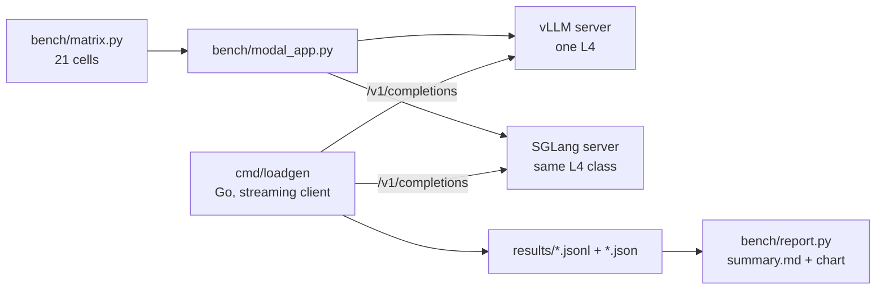
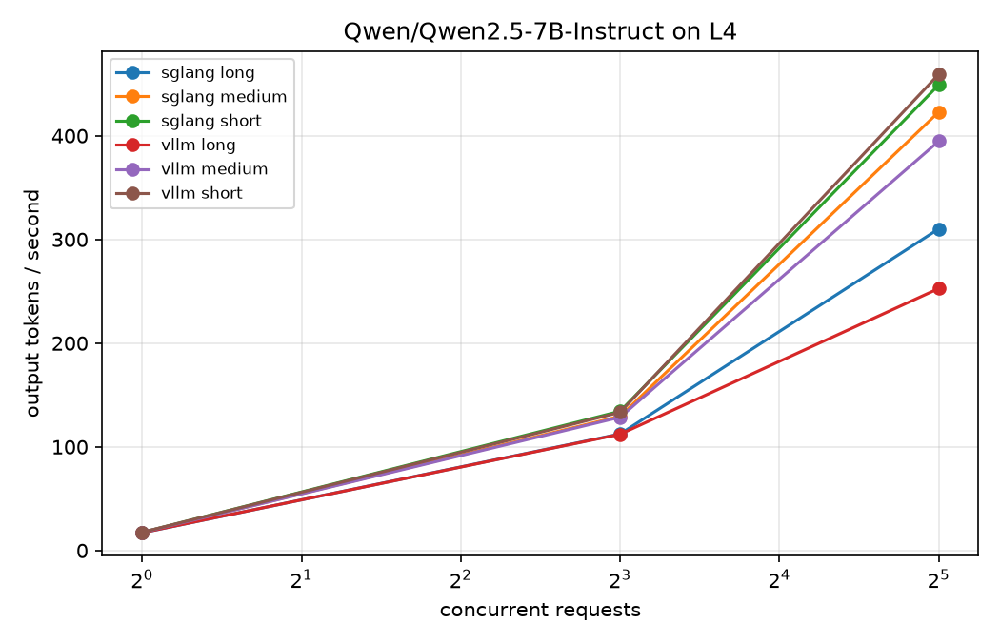

# inference-bench

vLLM against SGLang on one model and one GPU, measured by a Go load generator that times the first token at the client.

## Problem

Serving comparisons are usually quoted without the settings that decide them: which GPU, which dtype, how long the prompts were, whether prefix caching was on, and where the clock started. This repo pins the model, GPU class, sequence limits and caching mode across both engines, varies concurrency and prompt length, and records every request.

## Architecture



- The load generator runs inside the same Modal container as the engine, so the network is not part of TTFT.
- Both engines are started with the same model, dtype, context length and memory fraction, and are driven through the same `/v1/completions` path.
- Prompts come from a seeded generator in three length buckets, each a shared prefix plus a unique tail, so prefix caching has something to hit and something to miss. Output length is pinned with `max_tokens` and `ignore_eos`, and the engine's reported `completion_tokens` is counted.
- `matrix.py` is the single source for the run plan and its cost estimate; nothing spends money until `--confirm`.

## Quickstart

```bash
make test            # Go and Python tests, no GPU
make matrix          # print the run plan and what it should cost
make bench           # build the loadgen, run every cell on Modal, write the report
```

`make bench` needs a Modal account (`modal token new`) and pulls `results/` back when the matrix finishes. `make smoke` checks every image on CPU first, for about a cent. To drive an engine you already run:

```bash
go run ./cmd/loadgen -base-url http://127.0.0.1:8000 -model Qwen/Qwen2.5-7B-Instruct \
  -engine vllm -bucket medium -concurrency 8 -requests 32 -warmup 4
```

## Results

One NVIDIA L4, Qwen2.5-7B-Instruct in bf16, 128 output tokens per request with `ignore_eos`. Every engine start is followed by a discarded warm-up pass over all three prompt buckets, so the numbers below are steady state. Full table, cold starts and environment: `results/summary.md`.

| Engine | Cache | Bucket | Conc. | Output tok/s | TTFT p50 | TTFT p95 | TTFT p99 | $/1M out |
|---|---|---|---|---|---|---|---|---|
| vllm | on | short | 1 | 17.6 | 72 ms | 80 ms | 80 ms | $12.60 |
| sglang | on | short | 1 | 17.5 | 120 ms | 129 ms | 129 ms | $12.68 |
| vllm | on | short | 32 | 459.3 | 639 ms | 662 ms | 662 ms | $0.48 |
| sglang | on | short | 32 | 449.0 | 258 ms | 805 ms | 814 ms | $0.49 |
| vllm | on | long | 32 | 252.7 | 2318 ms | 6245 ms | 6670 ms | $0.88 |
| sglang | on | long | 32 | 310.2 | 449 ms | 6748 ms | 7276 ms | $0.72 |
| vllm | off | long | 32 | 147.1 | 2386 ms | 17113 ms | 18640 ms | $1.51 |



What the numbers say:

- Throughput is close between the engines at every concurrency. At one request each decodes about 17.5 tokens a second, which is roughly what an L4's memory bandwidth allows for a 7B model in bf16.
- SGLang reaches the first token sooner under load, 258 ms against 639 ms at 32 concurrent short prompts, while vLLM is quicker at a single request, 72 ms against 120 ms.
- Prefix caching is the largest effect here. On long prompts at 32 concurrent requests, turning it off takes vLLM from 252.7 to 147.1 tokens a second and p99 TTFT from 6.7 s to 18.6 s, because every request then re-runs prefill over a shared 2048 token prefix.
- Cost per million output tokens falls from $12.60 at one request to $0.48 at 32 on the same card, so idle capacity sets the price more than the engine does. Cold start sits outside all of this: SGLang served 122 s after launch, vLLM 149 s.

## Decisions

- TTFT is timed at the client, from sending the request to the first streamed chunk carrying text, because queueing is what a caller waits through and server logs do not show it.
- Warmup requests run before every cell and are thrown away, because the first requests pay for CUDA graph capture, allocator growth and lazy imports.
- One GPU class for every cell (L4, the cheapest 24 GB card on Modal), because a comparison across GPUs measures the hardware instead of the engine.
- Cost is reported per million output tokens, since an hourly rate hides the thing that differs between engines, which is how many tokens that hour buys.
- The model is Qwen2.5-7B-Instruct, not gated on Hugging Face, so a clone reproduces the run without an access request.
- Requests scale with concurrency (8, 32, 64) so a single-stream cell does not decode for five minutes while a batched cell finishes in twenty seconds.
- The load generator is Go: a closed-loop client holding N requests in flight is a few goroutines and a channel, and it stays cheap enough not to compete with the server for CPU.

## Limitations

- One run per cell in `results/`. The three vLLM cells at 32 concurrency were measured a second
  time while I fixed a labelling bug, and throughput moved by more than the gap between the two
  engines, so read small differences as noise rather than a ranking.
- Prompt length is controlled by word count from a fixed vocabulary, and the achieved `prompt_tokens` is recorded per request rather than forced to an exact number.
- Engine versions are pinned in `bench/modal_app.py`. Another release can move these numbers, and neither engine was tuned beyond matching the settings above.
- Cost per million tokens counts GPU seconds only. Container CPU and memory are in the estimate but not in the per-token figure.
- The comparison says nothing about output quality. It counts tokens, it does not read them.

## Stack

Go 1.27, Python 3.11, vLLM, SGLang, Modal, matplotlib, GitHub Actions.
