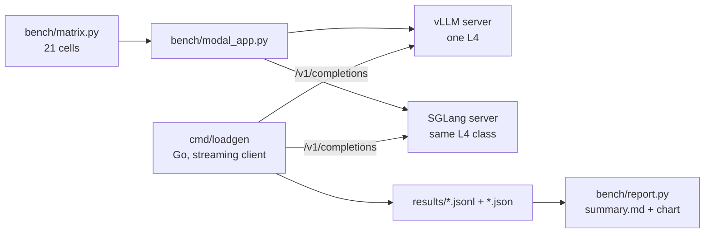

# inference-bench

vLLM against SGLang on one model and one GPU, measured by a Go load generator that times the first token at the client.

## Problem

Serving comparisons are usually quoted without the settings that decide them: which GPU, which dtype, how long the prompts were, whether prefix caching was on, and where the clock started. I wanted a comparison I could rerun and argue with, so this repo pins the model, the GPU class, the sequence limits and the caching mode across both engines, then varies concurrency and prompt length and records every request.

## Architecture



- The load generator runs inside the same Modal container as the engine, so the network is not part of TTFT.
- Both engines are started with the same model, dtype, context length and memory fraction, and are driven through the same `/v1/completions` path.
- Prompts come from a seeded generator in three length buckets, each built as a shared prefix plus a unique tail, so prefix caching has something to hit and something to miss.
- Output length is pinned with `max_tokens` and `ignore_eos`, and the engine's reported `completion_tokens` is what gets counted.
- `matrix.py` is the single source for the run plan and its cost estimate; nothing spends money until `--confirm`.

## Quickstart

```bash
make test            # Go and Python tests, no GPU
make matrix          # print the run plan and what it should cost
make bench           # build the loadgen, run every cell on Modal, write the report
```

`make bench` needs a Modal account (`modal token new`). It builds a linux/amd64 loadgen binary, ships it into the engine image, and pulls `results/` back when the matrix finishes. To drive an engine you already have running:

```bash
go run ./cmd/loadgen -base-url http://127.0.0.1:8000 -model Qwen/Qwen2.5-7B-Instruct \
  -engine vllm -bucket medium -concurrency 8 -requests 32 -warmup 4
```

## Results

not yet measured; see the run matrix in bench/matrix.py

## Decisions

- TTFT is timed at the client, from sending the request to the first streamed chunk carrying text, because queueing is what a caller waits through and server logs do not show it.
- Warmup requests run before every cell and are thrown away, because the first requests pay for CUDA graph capture, allocator growth and lazy imports.
- One GPU class for every cell (L4, the cheapest 24 GB card on Modal), because a comparison across GPUs measures the hardware instead of the engine.
- Cost is reported per million output tokens, since an hourly rate hides the thing that differs between engines, which is how many tokens that hour buys.
- The model is Qwen2.5-7B-Instruct, which is not gated on Hugging Face, so a clone can reproduce the run without an access request.
- Requests scale with concurrency (8, 32, 64) so a single-stream cell does not spend five minutes decoding while a batched cell finishes in twenty seconds.
- The load generator is Go because a closed-loop client with a fixed number of requests in flight is a few goroutines and a channel, and the client stays cheap enough not to compete with the server for CPU.

## Limitations

- One run per cell, so run-to-run variance is unmeasured.
- Prompt length is controlled by word count from a fixed vocabulary, and the achieved `prompt_tokens` is recorded per request rather than forced to an exact number.
- Engine versions are pinned in `bench/modal_app.py`; a different vLLM or SGLang release can move these numbers, and neither engine was tuned beyond matching the settings listed above.
- Cost per million tokens counts GPU seconds only. Container CPU and memory are in the estimate but not in the per-token figure.
- The comparison says nothing about output quality. It counts tokens, it does not read them.

## Stack

Go 1.27, Python 3.11, vLLM, SGLang, Modal, matplotlib, GitHub Actions.
